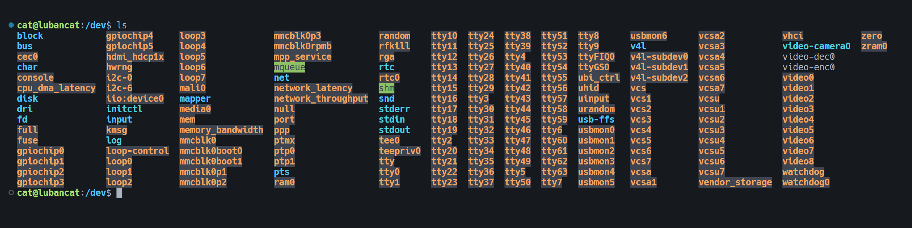

# Misc 设备驱动

## 一、简介

杂项设备驱动是属于我们Linux三大设备的哪一项？
由于Linux驱动倾向于分层设计，所以每个具体的设备都可以找到它归属的类型，从而可以套到它相应的架构里面区，我们只需要实现它最底层的那部分。但有部分字符设备，确实不知道属于那种类型，然后就推荐大家采用miscdevice的框架结构。

`misc`的意思是混合杂项的，所以misc设备驱动也叫做杂项设备驱动，当板子上的某个设备没有办法分类，就可以使用misc设备驱动。

它的注册与使用比较简单，所以适用于功能简单的设备。正应为简单，所以它通常嵌套在platform总线驱动中，配合总线驱动达到更复杂、多功能的效果，杂项设备是字符设备的一种，杂项设备可以自动生成设备节点。

在学习Misc设备驱动之前，先来了解几个基础概念。

### 概念1. 设备节点

启动开发板，进入到`dev`目录下，该目录下全是生成的设备节点，如下图所示：



系统中有很多的杂项设备，可以输入`cat/proc/misc`查看：


### 概念2. 杂项设备的优点

- 杂项设备比字符设备代码简单
- 所有的misc设备的驱动的主设备号都为10，不同的设备使用不同的从设备号。主设备设备号系统就可以节省内核的资源，再内核中大概可以找到200多处使用miscdevice框架结构的驱动。

### 概念3. 主设备号和次设备号的概念

设备号包含主设备号和次设备号，设备号是计算机识别设备的一种方式，主设备号相同就被视为同一类设备，主设备号再Linux系统是唯一的，次设备号不一定唯一。

主设备号可以通过以下命令查看：

`cat /proc/devices`


## 实验

```c
/*
 * @Description: 最简单的字符设备驱动
 * @Version: 1.0
 * @Author: topeet
 */
/*初始化头文件*/
#include <linux/init.h>
#include <linux/module.h>
#include <linux/miscdevice.h>
#include <linux/fs.h>

/*注册设备和定义文件操作*/
struct file_operations misc_fops = {
    .owner = THIS_MODULE
};
    // 杂项设备结构体
    struct miscdevice misc_dev = {
        .minor = MISC_DYNAMIC_MINOR,    //动态分配次设备号
        .name = "Hello_misc",           //设备名称 hello_misc
        .fops = &misc_fops,             //文件操作指针
};

/*初始化设备*/
static int misc_init(void)
{
    int ret;
    ret = misc_register(&misc_dev);
    if (ret < 0)
        printk("misc regist is error \n");
    printk("misc regist is succeed \n");
    return 0;
}

/*退出设备*/
static void misc_exit(void)
{ // 在卸载函数中注销杂项设备
    misc_deregister(&misc_dev);
    printk("misc goodbye! \n");
}

module_init(misc_init);
module_exit(misc_exit);
MODULE_LICENSE("GPL");
```


