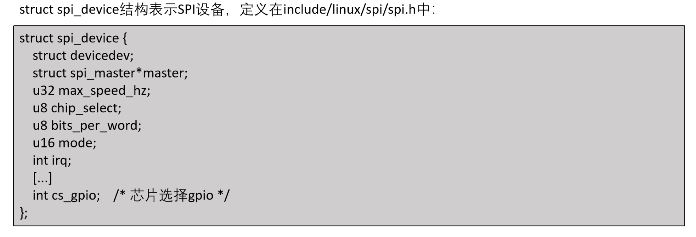
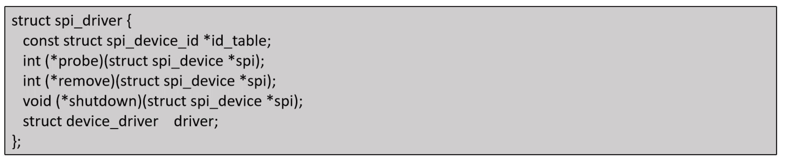
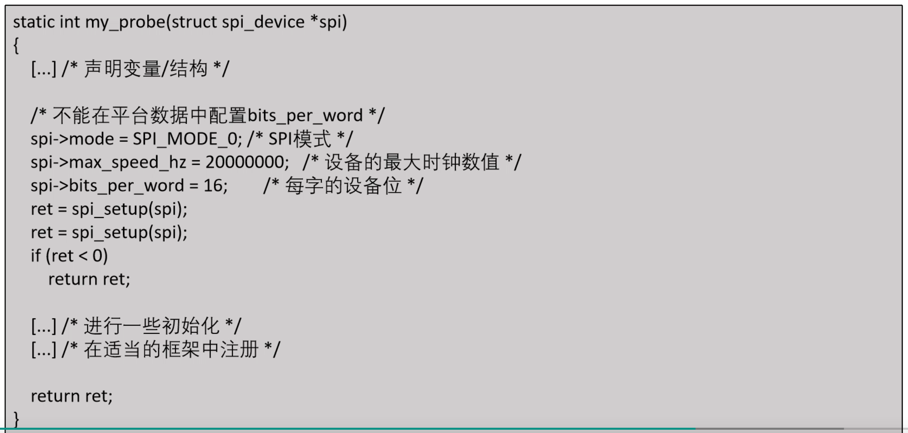
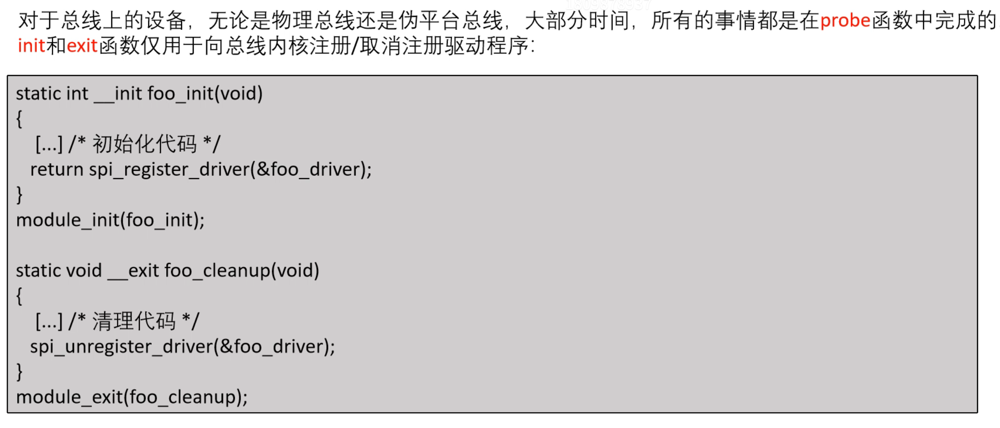

# SPI通信协议

一种全双工通信协议，可无中断传输数据，无数据包限制，通常用于芯片与芯片之间的通信。

- MOSI（Master Output/Slave Input) - 信号线，主机输出，从机输入。
- MOSI（Master Input/Slave Output）- 信号线，主机输入，从机输出
- SCLK - 时钟信号
- SS/CS(Slave Select/Chip Select) - 片选信号

## 协议原理

### 时钟信号

设备共享时钟信号的任何通信协议都称为**同步通信**。异步如Uart，就不共享时钟信号，而是设定好波特率。

### 片选信号

`CS/SS`用于使能通信，拉低从机的`ss/cs`选择与不同的从机通信。

### MOSI和MISO

## 数据传输

为了开始通信，总结上的主设备需要使用从设备支持的频率来配置时钟，这个频率最高为1兆赫兹左右。然后主设备会通过MOSI发送数据到从设备，主设备通过MISO读取从设备的数据（例如进行触控数据）。主设备会通过SCLK时钟信号来控制通信。

在每个SPI时钟周期内，都会发生全双工数据传输。主设备在MOSI线上发送一个位，从设备读取这个位；同时从设备在MISO线上发送一个位，主设备读取这个位。同时SPI协议支持主从制通信。

MISO线上发送一位数据，主机读取它。即使只有单向通信，主机也会在MISO线上发送一位数据，从机读取它。

传输寄存器通常包含8位。但是其他字长也很常见，例如触摸屏控制器TSC2011（）许多数据转换器支持单端或差分输入。许多数据转换器支持I2C和SPI接口。位字长可配置（12位字长）。

如果总线上没有被片选线激活的从设备波许忽略输入时钟和其`MOSI`信号，并且不得从`MISO`发送数据。

## 模式

> - CPOL（Clock Polarity）- 总线的极性
> - CPHA（Clock Phase） - 总线的相位

### SPI总线的极性

- 影响SPI总线空闲时是高电平还是低电平
- CPOL = 1：表示空闲是高电平
- CPOL = 0：表示空闲时低电平

### SPi总线的相位

- 一个时钟周期有下两个跳变沿，而相位，直接决定SPI总线从那个跳变沿开始采样数据。
- CPHA = 0：表示从第一个跳变沿开始采样
- CPHA = 1：表示从第二个跳变沿开始采样

# SPI设备驱动

主设备总是生成时钟，其速度可达到80MHz，实际上没用速度限制，CS线也是，一直由主设备管理。

## spi_device结构体

## spi_driver结构体

代表开发用于管理SPI设备的驱动程序

### probe函数

## 驱动程序的初始化与注册

