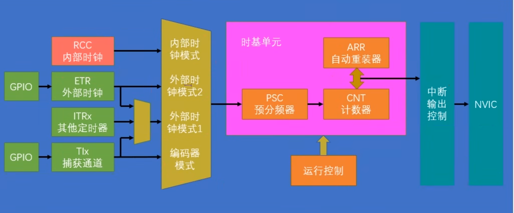

# STM32嵌入式开发之——Timer中断及外部时钟的使用（标准库）

# 前言

以STM32F10x系列为例，Timer定时器分为基本定时器、通用定时器、高级定时器，不同级别的定时器提供的功能有所不同：

| 定时器类型     | 功能模块                  | 说明与应用                                                   |
| -------------- | ------------------------- | ------------------------------------------------------------ |
| **基本定时器** | 1. 时基单元               | 由 PSC（预分频器）+ ARR（自动重装载值）组成，产生定时中断或触发DAC |
|                | 2. 时基单元的工作流程     | CNT 从 0 计数到 ARR，溢出产生更新事件（UEV），用于中断或触发操作 |
|                | 3. 主模式触发 DAC 功能    | TIM6/TIM7 可配置 TRGO 输出，作为 DAC 的硬件触发源            |
| **通用定时器** | 1. 与基本定时器的异同     | 通用定时器支持通道输入输出、编码器接口，而基本定时器仅支持定时功能 |
|                | 2. 内外时钟源选择功能     | 可选择内部时钟（CK_INT）或外部触发（ETR/TIx）作为计数时钟    |
|                | 3. 编码器接口功能         | 配置 TIMx 为编码器模式，读取正交编码器的计数/方向信息        |
|                | 4. 主从触发模式功能       | 多定时器同步启动、同步清零，通过触发控制器（TRGO/TS）连接    |
|                | 5. 输出比较功能           | 到达设定时间输出翻转、置位、复位、强制电平等，用于 PWM、单脉冲输出等 |
|                | 6. 输入捕获电路           | 捕捉输入信号上升/下降沿的 CNT 值，实现频率、周期、占空比测量 |
| **高级定时器** | 1. 重复计数器             | RCR：控制更新事件每发生 N 次才触发一次真正更新（常用于周期控制） |
|                | 2. 死区生成电路与电机控制 | 提供互补 PWM 输出及死区时间插入，驱动三相无刷电机等功率应用  |
|                | 3. 刹车输入（Break）      | 接收外部紧急信号，关闭 PWM 输出，保障电路和系统安全          |
| **中断结构**   | 定时中断基本结构          | 配置时基 + 启用中断 + NVIC + 编写 ISR，执行周期性任务或控制逻辑 |
| **时序分析**   | 1. 缓冲（影子）寄存器     | PSC、ARR、CCR 等寄存器具有影子功能，更新需触发 UEV（更新事件） |
|                | 2. 预分频器时序分析       | PSC 分频作用：实际 CNT 增加速率 = 时钟频率 / (PSC+1)         |
|                | 3. 计数器时序分析         | CNT 支持向上、向下、中心对齐计数模式，影响 PWM 波形对称性    |
|                | 4. RCC 时钟树简介         | TIM1 属于 APB2（72MHz），TIM2~TIM4 属于 APB1（36MHz ×2 = 72MHz） |

这里主要对几种不同的定时器进行比较总结，更详细的解析参见 [江协科技/江科大-STM32入门教程-11.TIM定时中断_通用定时器和基本定时器的区别-CSDN博客](https://blog.csdn.net/m0_61712829/article/details/132525577?csdn_share_tail={"type"%3A"blog"%2C"rType"%3A"article"%2C"rId"%3A"132525577"%2C"source"%3A"m0_61712829"})。

---

# 标准库Timer相关库函数

 STM32 标准外设库（StdPeriphLib）中 **TIM 定时器相关函数**用于配置和控制 `TIM1~TIM17` 等通用定时器、基本定时器和高级定时器的行为。

下面我按功能模块，简明分类讲解这些函数 **是做什么的、什么时候用**：

------

## 1. 基本初始化相关

| 函数                       | 作用                                                         |
| -------------------------- | ------------------------------------------------------------ |
| `TIM_DeInit()`             | 复位 TIM 外设寄存器（恢复默认值）                            |
| `TIM_TimeBaseInit()`       | 设置定时器计数器基础参数，如 `计数周期`、`预分频`、`计数方向` |
| `TIM_TimeBaseStructInit()` | 初始化 `TIM_TimeBaseInitTypeDef` 结构体为默认值（常用于初始化前） |

------

## 2. 计数器设置 / 启动控制

| 函数                      | 作用                               |
| ------------------------- | ---------------------------------- |
| `TIM_Cmd()`               | 启动/停止定时器                    |
| `TIM_SetCounter()`        | 设置当前计数值                     |
| `TIM_GetCounter()`        | 读取当前计数值                     |
| `TIM_SetAutoreload()`     | 设置自动重装载值（ARR）            |
| `TIM_GetPrescaler()`      | 获取当前预分频值                   |
| `TIM_SetPrescaler()`      | 设置预分频器                       |
| `TIM_PrescalerConfig()`   | 同上 + 可立即生效或等下次更新      |
| `TIM_CounterModeConfig()` | 设置计数模式（向上/向下/中心对齐） |
| `TIM_SetClockDivision()`  | 设置时钟分频                       |

------

## 3. 输出比较（PWM）相关配置

| 函数                       | 作用                                             |
| -------------------------- | ------------------------------------------------ |
| `TIM_OCxInit()`            | 初始化 OC 通道（x=1~4），配置 PWM 模式、比较值等 |
| `TIM_OCStructInit()`       | 初始化 `TIM_OCInitTypeDef` 结构体                |
| `TIM_CCxCmd()`             | 控制通道输出使能（TIMx_CHx）                     |
| `TIM_CCxNCmd()`            | 控制互补通道输出（高级定时器才有）               |
| `TIM_OCxPreloadConfig()`   | 设置通道预装载（更新事件时才更新寄存器）         |
| `TIM_OCxFastConfig()`      | 快速比较模式                                     |
| `TIM_OCxPolarityConfig()`  | 设置输出极性（高电平有效或低电平有效）           |
| `TIM_OCxNPolarityConfig()` | 设置互补输出极性（高级定时器）                   |
| `TIM_SetCompareX()`        | 设置通道的比较值（决定 PWM 占空比）              |
| `TIM_ForcedOCxConfig()`    | 强制输出高/低电平                                |
| `TIM_ClearOCxRef()`        | 清除比较参考输出                                 |
| `TIM_SelectOCxM()`         | 设置 OCx 模式（PWM模式1/2、强制高低等）          |

------

## 4. 输入捕获 / 编码器 / PWM输入

| 函数                           | 作用                                       |
| ------------------------------ | ------------------------------------------ |
| `TIM_ICInit()`                 | 初始化输入捕获通道（测量信号频率、周期等） |
| `TIM_ICStructInit()`           | 初始化 `TIM_ICInitTypeDef`                 |
| `TIM_GetCaptureX()`            | 获取捕获值                                 |
| `TIM_SetICxPrescaler()`        | 设置输入捕获分频（每N个边沿触发）          |
| `TIM_PWMIConfig()`             | 用输入捕获测量 PWM 信号（周期+高电平时间） |
| `TIM_EncoderInterfaceConfig()` | 配置为编码器接口模式                       |
| `TIM_SelectHallSensor()`       | 用于电机霍尔传感器接口                     |

------

## 5. 时钟源选择——触发 / 同步 / 外部时钟

| 函数                            | 作用                             |
| ------------------------------- | -------------------------------- |
| `TIM_SelectInputTrigger()`      | 选择触发源（内部/外部/其他通道） |
| `TIM_SelectOutputTrigger()`     | 设置 TRGO 输出源                 |
| `TIM_SelectSlaveMode()`         | 设置为从模式（响应外部触发）     |
| `TIM_SelectMasterSlaveMode()`   | 设置主从同步                     |
| `TIM_ETRClockMode1Config()`     | 使用 ETR 外部时钟模式1           |
| `TIM_ETRClockMode2Config()`     | 外部时钟模式2                    |
| `TIM_TIxExternalClockConfig()`  | 使用 TIx 通道作为外部时钟        |
| `TIM_ITRxExternalClockConfig()` | 使用内部触发源作为时钟           |
| `TIM_ETRConfig()`               | 配置 ETR 极性、滤波器等          |

------

## 6. 更新控制 / 中断 / DMA

| 函数                                            | 作用                               |
| ----------------------------------------------- | ---------------------------------- |
| `TIM_UpdateDisableConfig()`                     | 禁用更新事件（UG）                 |
| `TIM_UpdateRequestConfig()`                     | 设置是否在计数溢出时才生成更新事件 |
| `TIM_ITConfig()`                                | 启用中断（如更新中断）             |
| `TIM_GetITStatus()` / `TIM_ClearITPendingBit()` | 获取/清除中断状态                  |
| `TIM_GenerateEvent()`                           | 手动触发事件（UG、CCxG等）         |
| `TIM_DMAConfig()`                               | 配置 DMA 的起始基地址和突发长度    |
| `TIM_DMACmd()`                                  | 启用/禁用某个 DMA 请求             |

------

## 7. 高级定时器专属功能（如 TIM1）

| 函数                   | 作用                                     |
| ---------------------- | ---------------------------------------- |
| `TIM_BDTRConfig()`     | 设置刹车、死区、输出使能（用于电机控制） |
| `TIM_BDTRStructInit()` | 初始化 BDTR 结构体                       |
| `TIM_CtrlPWMOutputs()` | 控制高级定时器 PWM 输出总开关            |
| `TIM_SelectCOM()`      | 开启 COM 事件（互补 PWM 相关）           |
| `TIM_SelectCCDMA()`    | 允许使用 DMA 传输比较寄存器              |

------

## 总结：这些函数的主要用途

| 类型       | 用于配置/控制          |
| ---------- | ---------------------- |
| 定时功能   | 生成周期性中断         |
| PWM输出    | 电机驱动、LED调光等    |
| 输入捕获   | 测量外部信号频率、周期 |
| 编码器模式 | 读取旋转编码器位置     |
| 外部时钟   | 使用外部信号作为定时源 |
| 中断/DMA   | 自动触发外设响应事件   |
| 高级控制   | 电机控制、死区保护等   |

---

# 定时中断

定时中断基本结构框图如下：



- 定时中断初始化流程

  ```text
  第一步，RCC开启时钟，定时器的基准时钟和整个外设的工作时钟就都打开了
  第二步，选择时基单元的时钟源，对于定时中断就选择内部时钟源
  第三步，配置时基单元，包括预分频器、自动重装载器、计数模式等，参数用结构体配置
  第四步，配置输出中断控制，允许更新中断输出到NVIC
  第五步，配置NVIC，在NVIC中打开定时器中断通道并分配一个优先级
  第六步，运行控制，使能计数器，当定时器使能后，计数器就开始计数了，当计数器更新时，触发中断
  最后再写一个中断函数，中断函数每隔一段时间就能自动执行一次
  ```
## 1、开启时钟
- 定时器上电后默认选择内部时钟，若需要内部时钟，下面的代码可省略：

  ```c
  TIM_InternalClockConfig(TIM_TypeDef* TIMx);
  ```

## 2、时基单元初始化函数`TIM_TimBaseInit`参数配置
### 1. `TIM_ClockDivision`（采样时钟分频频率选择）

> 适用于滤波器采样频率设定，不直接影响时基单元。

- 外部输入信号可能会抖动，通过滤波器采样判断是否稳定。
- 采样频率越低、采样点越多，滤波效果越好，但延迟越大。
- `TIM_ClockDivision` 设置分频倍数，用于采样滤波，常见选项：
  - `TIM_CKD_DIV1`：不分频
  - `TIM_CKD_DIV2`：2分频
  - `TIM_CKD_DIV4`：4分频

---

### 2. `TIM_CounterMode`（计数器模式）

- 决定计数的方向或方式：
  - `TIM_CounterMode_Up`：向上计数
  - `TIM_CounterMode_Down`：向下计数（用于特殊情况）
  - `TIM_CounterMode_CenterAligned1/2/3`：中心对齐模式，PWM 更平滑

---

### 3. `TIM_Period`（自动重装载值 ARR）

- 定义定时器计数周期，当计数器值 CNT 到达该值时溢出并触发中断。
- 有效范围：0 ~ 65535

---

### 4. `TIM_Prescaler`（预分频器值 PSC）

- 对输入时钟（如72MHz）进行预分频，降低计数频率。
- 有效范围：0 ~ 65535

---

### 5. `TIM_RepetitionCounter`（重复计数器）

- 仅高级定时器（如 TIM1、TIM8）有效，通用定时器无需设置，可置 0。

---

### 6. 定时时间计算

参考公式: `CK_CNT_OV = CK_PSC / (PSC + 1) / (ARR + 1)`
其中：

- `CK_PSC` 是定时器时钟（一般为 72MHz）
- `PSC` 是预分频值
- `ARR` 是自动重装载值

举例：  
若定时 1 秒，CK_PSC = 72MHz：
72,000,000 / (7200) / (10000) = 1Hz → 每秒溢出一次（定时 1 秒）
- 即设置：
  - `PSC = 7200 - 1`
  - `ARR = 10000 - 1`

📝 **提示：** PSC 和 ARR 的组合并不唯一，只要乘积满足要求即可。

---

### 7. 更新事件行为

> 在 `TIM_TimeBaseInit()` 调用后，立即触发一次“更新事件”。

- 原因：PSC 和 ARR 都是带缓冲寄存器的，写入值只有在更新事件发生后才生效。
- 初始化时自动触发一次更新事件，让寄存器立即加载新值。
- 注意：更新事件会同时触发更新中断，建议**手动清除更新中断标志**，防止初始化阶段误进中断。

```c
TIM_ClearITPendingBit(TIMx, TIM_IT_Update); // 清除更新中断标志
```

## 3、使能中断函数`TIM_ITConfig`
```c
TIM_ITConfig(TIM2,TIM_IT_Update,ENABLE); //开启更新中断到NVIC的通道
```
## 4、启动定时器 
```c
TIM_Cmd(TIM2,ENABLE);//当产生更新时，就会触发中断
```
## 程序代码


# 定时器外部时钟选择

## 外部时钟配置函数 `TIM_ETRClockMode2Config`

外部时钟可以通过定时器的 ETR（外部触发输入）引脚输入，调用 `TIM_ETRClockMode2Config()` 进行配置。

```c
TIM_ETRClockMode2Config(TIMx, TIM_ExtTRGPrescaler_x, TIM_ExtTRGPolarity_x, ExtTRGFilter);
```

### 参数说明

1. **TIM_ExtTRGPrescaler**：外部时钟预分频器

- 可选值：
  - `TIM_ExtTRGPSC_OFF`：1 分频（不分频）
  - `TIM_ExtTRGPSC_DIV2`：2 分频
  - `TIM_ExtTRGPSC_DIV4`：4 分频
  - `TIM_ExtTRGPSC_DIV8`：8 分频

1. **TIM_ExtTRGPolarity**：外部触发极性选择

- `TIM_ExtTRGPolarity_NonInverted`：不反向，高电平或上升沿有效
- `TIM_ExtTRGPolarity_Inverted`：反向，低电平或下降沿有效

1. **ExtTRGFilter**：外部输入滤波器

- 可选值范围：`0x00` ~ `0x0F`
- 数值越大，滤波时间越长，抗干扰能力越强，但响应延迟增加
- 每个值对应一个固定采样频率 f 和采样数 N，具体查阅芯片参考手册（RM）

------

## GPIO 配置要求

由于外部时钟输入依赖于物理引脚的信号输入，需提前配置对应的 GPIO 引脚：

- 推荐配置：
  - 默认：浮空输入模式（`GPIO_Mode_IN_FLOATING`）
  - 若信号功率足够大：可选上拉或下拉输入，提升抗干扰能力
  - 若信号功率较小：建议使用浮空输入，避免内部上拉/下拉电阻影响外部信号

```c
GPIO_InitStructure.GPIO_Pin = GPIO_Pin_x;
GPIO_InitStructure.GPIO_Mode = GPIO_Mode_IN_FLOATING;  // 或使用 GPIO_Mode_IPU/IPD
GPIO_Init(GPIOx, &GPIO_InitStructure);
```

> 📌 外部时钟接入场景适用于编码器解码、脉冲计数器、红外测距等高精度信号处理。

## 程序代码


# 参考文章

[江协科技/江科大-STM32入门教程-11.TIM定时中断_通用定时器和基本定时器的区别-CSDN博客](https://blog.csdn.net/m0_61712829/article/details/132525577?csdn_share_tail={"type"%3A"blog"%2C"rType"%3A"article"%2C"rId"%3A"132525577"%2C"source"%3A"m0_61712829"})

[江协科技/江科大-STM32入门教程-12.示例程序（定时器定时中断&定时器外部时钟）_stm32 定时器代码-CSDN博客](https://blog.csdn.net/m0_61712829/article/details/132563138?csdn_share_tail={"type"%3A"blog"%2C"rType"%3A"article"%2C"rId"%3A"132563138"%2C"source"%3A"m0_61712829"})